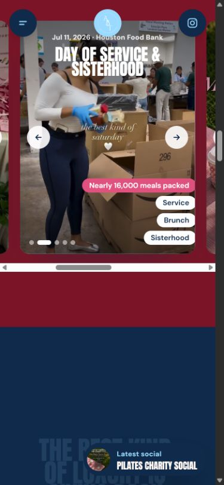

# A Better Tomorrow Social

A website for **A Better Tomorrow Social**, a Houston social club for women
centered on connection, empowerment, and giving back. The experience introduces
the club, celebrates its gatherings, and helps visitors find events and express
interest in joining.

## Screenshots

### Desktop


### Mobile


### Event gallery



## Features

- Animated introduction, typography, and image cards.
- Smooth section navigation and scroll-driven transitions.
- Responsive layouts for desktop and mobile.
- Event galleries with photo controls and video highlights.
- Three club pillars: socials and soirées, days of service, and wellness and mindfulness.
- Expandable frequently asked questions.
- A three-question membership and partnership inquiry quiz.
- Links to the club's Instagram and event tickets.
- Local fonts, images, icons, and video assets.
- Sky, pink, and navy accent themes selected on page load.

## Technology

| Area | Technology |
| --- | --- |
| Frontend | HTML, CSS, and JavaScript with React browser assets |
| Animation | GSAP and Lenis |
| API | Python WSGI application |
| Inquiry storage | SQLite for local development; optional Google Cloud Firestore |
| Production server | Nginx and Gunicorn |
| Containers | Docker Compose |

## Run locally

Use **Python 3.11 or later**. From the repository root:

```sh
python server.py --port 8765
```

Open [http://127.0.0.1:8765/](http://127.0.0.1:8765/).

The local server serves the frontend and the inquiry endpoint. SQLite is the
default storage backend, with data saved under `data/`. This mode requires no
extra Python packages or cloud credentials. The built-in server is intended
for development; use the production configuration for a public deployment.

## Project structure

```text
public/
  index.html                  Main website
  _next/static/               Frontend scripts, styles, and fonts
  media/                      Photography and event videos
server.py                     Static server and inquiry API
requirements.txt              Production Python dependencies
gunicorn.conf.py              Python worker configuration
nginx.conf                    Static hosting and API proxy
Dockerfile                    API container
compose.yaml                  Web and API services
compose.firestore.yaml        Optional Firestore credential configuration
.env.example                  Environment variable template
verification/                 Screenshots and verification report
```

## Inquiry API

The quiz submits JSON to `POST /api/join`:

```json
{
  "name": "First name",
  "email": "person@example.com",
  "instagram": "@optional",
  "answers": [
    {"q": "What brings you to ABT?", "a": "A bit of everything"},
    {"q": "You are…", "a": "Interested in membership"},
    {"q": "Your perfect social?", "a": "Surprise me"}
  ]
}
```

The endpoint validates the input and returns success after saving the inquiry.
The interface then displays a confirmation. A failed request offers the club's
Instagram contact option.

### Firestore

To use Firestore, install the client library and configure these environment
variables on the API server:

```sh
python -m pip install google-cloud-firestore==2.34.1
```

```text
JOIN_STORAGE=firestore
FIRESTORE_PROJECT_ID=your-project-id
FIRESTORE_DATABASE_ID=(default)
FIRESTORE_COLLECTION=join_submissions
```

The server uses Application Default Credentials. Configure an appropriate
server identity with Firestore access, or point `GOOGLE_APPLICATION_CREDENTIALS`
to a private ADC configuration file. Keep credentials outside `public/` and
out of Git. Firestore requires a configured project, database, and permissions
before inquiries can be saved there.

### Optional email notifications

Configure `SMTP_HOST`, `SMTP_PORT`, `SMTP_USER`, `SMTP_PASSWORD`, `MAIL_FROM`,
and `JOIN_TO_EMAIL` to send inquiry notifications. Storage works without email.
The inquiry is saved before notification delivery is attempted.

## Docker

With Docker and Docker Compose installed:

1. Copy `.env.example` to `.env` and configure the required settings.
2. Run the services:

   ```sh
   docker compose up -d --build
   ```

3. Open [http://127.0.0.1:8080/](http://127.0.0.1:8080/).

For Firestore with an existing ADC file, set `FIRESTORE_PROJECT_ID` and
`GOOGLE_CREDENTIALS_FILE` in `.env`, then use the optional overlay:

```sh
docker compose -f compose.yaml -f compose.firestore.yaml up -d --build
```

The default web port binds to loopback. Configure your HTTPS reverse proxy
and domain for a public deployment, preserving the visitor's Host header.
Nginx serves the static assets and videos and proxies the inquiry endpoint
to Gunicorn. Inquiry requests are rate-limited in the Nginx configuration.

## Inquiry management

Export inquiries to a private CSV or retry pending email notifications using
the configured storage backend:

```sh
python server.py --export-csv /private/path/inquiries.csv
python server.py --retry-notifications
```

The repository excludes runtime databases, CSV exports, and `.env` files.
